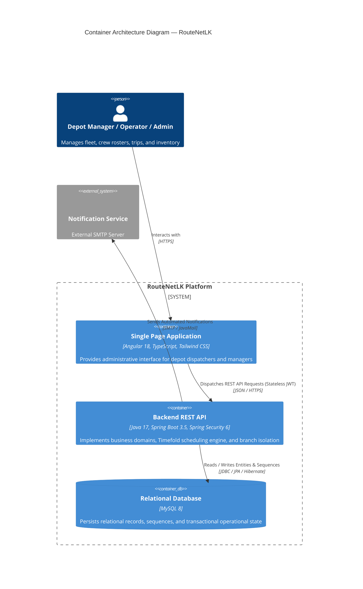
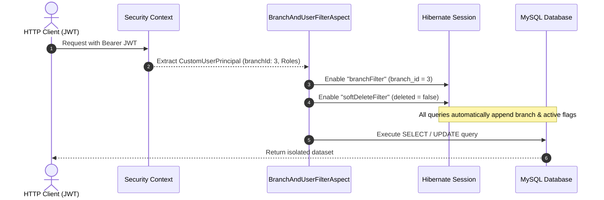

# RouteNetLK — Enterprise Transport Operations Backend

<p align="center">
  
  
  
  
  
  
  
  
</p>

<p align="center">
  A production-grade, modular backend application engineered for public transport depot management, automated crew rostering, fleet lifecycle tracking, and inventory operations. Built with <strong>Spring Boot 3.5</strong>, <strong>Timefold Solver (AI constraint satisfaction)</strong>, and <strong>MySQL 8</strong>.
</p>

<p align="center">
  <strong>System Ecosystem:</strong>
  <a href="https://github.com/Ashan-Dissanayake/RouteNetLK">System Overview</a> •
  <a href="https://github.com/Ashan-Dissanayake/RouteNetLKClientApplication">Angular Frontend Client</a> •
  <a href="#system-architecture--design">C4 Diagrams</a> •
  <a href="#architectural-decision-records-adrs">Engineering ADRs</a>
</p>

---

## 📌 Executive Summary

> **Why RouteNetLK stands out:** It addresses real-world industrial complexities in transportation logistics—handling multi-tenant data isolation, non-deterministic NP-hard resource allocation, high-security authentication filters, and robust domain event coordination.

| Core Engineering Capability | Technical Implementation Highlights |
|---|---|
| **Operations Research & Optimization** | Integrates **Timefold Solver 1.32.0** with **Interval Trees** to solve crew shift scheduling and conflict detection with **$\mathcal{O}(\log N)$** query complexity instead of $\mathcal{O}(N)$. |
| **Multi-Tenant Branch Data Isolation** | Transparent branch scoping via dynamic **Hibernate Filters**, **Spring AOP aspects**, and custom **JPA Entity Listeners** (`@CurrentBranch`), preventing cross-depot data leakage without polluting business queries. |
| **Enterprise Security & Brute-Force Defense** | Stateless **Spring Security 6 with JWT**, combined with Google Guava `LoadingCache` providing **dual-tier rate limiting** (username account locking + IP-based ban protection). |
| **Architectural Rigor & Documentation** | Governed by **11 formal Architecture Decision Records (ADRs)** and comprehensive **C4 Model architecture diagrams** (Context, Container, Component, Low-Level Design). |
| **Decoupled Event-Driven Domain Workflows** | Leverages in-process **Spring Application Events** for domain state propagation (permits, spare part requisitions, fare reconciliations, and audit logging). |
| **Exhaustive Testing Pyramid** | Comprehensive coverage with **JUnit 5 / Mockito** (Unit), **MockMvc** (Web Layer), **Testcontainers** (MySQL Integration), and **Timefold ConstraintVerifier** (Constraint rules). |

---

## 📑 Table of Contents

- [Recruiter Executive Summary](#-recruiter--hiring-manager-executive-summary)
- [System Architecture & Design](#-system-architecture--design)
- [Architectural Decision Records (ADRs)](#-architectural-decision-records-adrs)
- [Key Business Modules](#-key-business-modules)
- [Deep Dive: Core Engineering Innovations](#-deep-dive-core-engineering-innovations)
  - [1. Constraint-Based Crew Rostering (Timefold Solver)](#1-constraint-based-crew-rostering-timefold-solver)
  - [2. Multi-Tenant Branch Isolation & Soft Deletes (AOP + Hibernate Filters)](#2-multi-tenant-branch-isolation--soft-deletes-aop--hibernate-filters)
  - [3. Enterprise Security & Abuse Prevention](#3-enterprise-security--abuse-prevention)
  - [4. Event-Driven Workflow Orchestration](#4-event-driven-workflow-orchestration)
  - [5. API Design & Centralized Error Handling](#5-api-design--centralized-error-handling)
- [Testing Strategy](#-testing-strategy)
- [Technology Stack Matrix](#-technology-stack-matrix)
- [Project Directory Structure](#-project-directory-structure)
- [Getting Started & Local Setup](#-getting-started--local-setup)
- [Docker & CI/CD Pipeline](#-docker--cicd-pipeline)
- [Engineering Roadmap](#-engineering-roadmap)
- [Author & Contact](#-author--contact)

---

## 🏛️ System Architecture & Design

RouteNetLK is structured as a **clean, modular monolithic backend**, achieving strong domain boundary separation while eliminating the distributed system overhead of microservices for single-depot transactional integrity.

### Container & Boundary Overview (C4 Level 2)



### Detailed Design Documents

For detailed diagrams and architectural specifications, explore the design documentation:
- 📘 **[C4 Model Architecture Specifications (docs/diagrams/c4-model.md)](docs/diagrams/c4-model.md)**: Full breakdown of System Context (Level 1), Containers (Level 2), Component Architecture (Level 3), and Code Organization (Level 4).
- 📗 **[Roster Module Low-Level Design (docs/diagrams/roster-lld.md)](docs/diagrams/roster-lld.md)**: Detailed entity-relationship class diagrams, sequence flows for automated shift generation, and Timefold score rule evaluation.

---

## 📑 Architectural Decision Records (ADRs)

Every major architectural trade-off and framework choice is formally documented following the ADR pattern. Review each decision below:

| ADR ID | Decision Title | Focus Area | Architectural Rationale & Link |
|---|---|---|---|
| **0001** | **[Technologies and Frameworks](docs/adr/0001-technologies-and-frameworks.md)** | Core Stack | Selection of Java 17 LTS, Spring Boot 3.5, MySQL 8, and Timefold Solver for long-term support and type safety. |
| **0002** | **[Overall Architecture & Organization](docs/adr/0002-overall-architecture-organization.md)** | System Design | Adoption of a modular layered architecture to preserve high cohesion and clean domain boundaries. |
| **0003** | **[Development Standards & Code Quality](docs/adr/0003-development-standards-and-code-quality.md)** | Code Quality | Separation of concerns using DTOs, MapStruct compile-time mappers, and Lombok boilerplate reduction. |
| **0004** | **[Data Management & Persistence](docs/adr/0004-data-management-and-persistence.md)** | Persistence | Hibernate filters, soft delete aspects, JPA Auditing, and automated `@CurrentBranch` context injection. |
| **0005** | **[Security and Identity](docs/adr/0005-security-and-identity.md)** | Auth & Security | Stateless JWT authentication, granular `module-operation` privileges, and dual-layer Guava cache brute-force defense. |
| **0006** | **[Integration & Communication](docs/adr/0006-integration-and-communication.md)** | API & Events | Unified response wrapper format, RFC-compliant error mapping, and asynchronous email notification services. |
| **0007** | **[Performance and Scalability](docs/adr/0007-performance-and-scalability.md)** | Optimization | Interval Tree $\mathcal{O}(\log N)$ conflict detection, Timefold meta-heuristics, and JVM memory tuning. |
| **0008** | **[Reliability & Resilience](docs/adr/0008-reliability-and-resilience.md)** | Transactions | Declarative Spring `@Transactional` boundaries, optimistic locking, and strict state machine transitions. |
| **0009** | **[Observability and Monitoring](docs/adr/0009-observability-and-monitoring.md)** | Observability | Structured SLF4J logging, correlation IDs, and Spring Boot Actuator health and metric endpoints. |
| **0010** | **[Infrastructure and Deployment](docs/adr/0010-infrastructure-and-deployment.md)** | DevOps | Multi-stage Docker containerization and automated GitHub Actions build/deployment pipelines. |
| **0011** | **[Test Implementation Strategy](docs/adr/0011-test-implementation-strategy.md)** | Testing | Isolated Testcontainers MySQL suite, `@WebMvcTest` controller validation, and constraint verifiers. |

---

## 📦 Key Business Modules

The backend contains 16 decoupled domain modules encapsulating end-to-end transport depot workflows:

```
src/main/java/lk/ashan/routenetlkserverapllication/module/
 ├── branch/                    # Depot & regional branch operations
 ├── crew/                      # Crew assignments & qualification records
 ├── employee/                  # HR records, employee designations, and licensing
 ├── farecollection/            # Daily fare revenue logging and cash reconciliation
 ├── grn/                       # Goods Received Notes for inventory stock updates
 ├── incident/                  # Road accidents, breakdowns, and vehicle defect reports
 ├── incidentvehicleallocation/ # Rapid emergency vehicle dispatch for disrupted trips
 ├── partrequest/               # Spare-part requisition & departmental approvals
 ├── permit/                    # Route permits, validity checking, and inter-branch transfers
 ├── privilege/                 # Granular RBAC permissions management
 ├── roster/                    # Timefold-powered automated shift assignment & validation
 ├── sparepart/                 # Warehouse inventory, reorder levels, and part catalog
 ├── trip/                      # Timetables, scheduled journeys, and route definitions
 ├── tripexecution/             # Real-time trip status tracking (Departed, En Route, Completed)
 ├── user/                      # User authentication, credential policies, and status
 └── vehicle/                   # Bus fleet registry, technical specs, and odometer records
```

---

## 🔍 Deep Dive: Core Engineering Innovations

### 1. Constraint-Based Crew Rostering (Timefold Solver)
Managing public transport shifts involves balancing hard regulatory requirements with soft crew preferences—an NP-hard combinatorial problem.

* **Hard Constraints (Must Satisfy):**
  * Designation compatibility (Drivers assigned only to driving shifts; Conductors to ticketing).
  * No overlapping shifts for the same crew member.
  * Required staffing counts per route/shift strictly respected.
* **Soft Constraints (Optimization Penalties):**
  * Uniform workload and shift distribution across available personnel.
  * Fair rest period distribution between consecutive working days.
* **Conflict Detection Optimization:**
  * Uses a custom **Interval Tree** algorithm reducing schedule collision checks from $\mathcal{O}(N)$ to **$\mathcal{O}(\log N)$**.
* *Architecture Ref:* See [ADR 0007 (docs/adr/0007-performance-and-scalability.md)](docs/adr/0007-performance-and-scalability.md) and [Roster LLD (docs/diagrams/roster-lld.md)](docs/diagrams/roster-lld.md).

---

### 2. Multi-Tenant Branch Isolation & Soft Deletes (AOP + Hibernate Filters)
Public transport systems operate across distributed regional depots. A depot manager in Colombo must not view or mutate data belonging to Kandy, while Super Admins need complete cross-depot visibility.



* **Zero Query Pollution:** Developers write clean JPA queries without manual `WHERE branch_id = :id` clauses.
* **Dynamic AOP Bypass:** Special administrative routines use `@DisableBranchFilter` and `@DisableSoftDeleteFilter` for system-wide auditing and recovery.
* *Architecture Ref:* See [ADR 0004 (docs/adr/0004-data-management-and-persistence.md)](docs/adr/0004-data-management-and-persistence.md).

---

### 3. Enterprise Security & Abuse Prevention
* **Stateless Token Pipeline:** Spring Security 6 filter chain with stateless JWT authentication (`io.jsonwebtoken`).
* **Brute-Force & Denial-of-Service Defense:**
  * **Account Protection:** Google Guava `LoadingCache` locks accounts for 5 seconds after 3 consecutive failed login attempts.
  * **IP Quarantine:** Tracks failed requests per IP address, blocking offender IPs for 15 minutes after 5 failures.
* **Granular Method Authorization:** Uses `@PreAuthorize("hasAuthority('...')")` enforcing explicit `module-operation` privileges (e.g., `vehicle-update`, `roster-generate`).
* *Architecture Ref:* See [ADR 0005 (docs/adr/0005-security-and-identity.md)](docs/adr/0005-security-and-identity.md).

---

### 4. Event-Driven Workflow Orchestration
Critical operational updates trigger in-process Spring Application Events to decouple secondary actions (notifications, inventory balance adjustment, and audit logging):

* `PermitTransferredEvent`: Dispatches notification emails and updates depot route quotas.
* `FareReconciledEvent`: Finalizes cash auditing and marks trip execution records as reconciled.
* `PartRequestApprovedEvent`: Alerts warehouse officers and reserves parts in stock.
* `PartReceivedEvent`: Automatically updates stock counts and generates Goods Received Notes (GRN).
* *Architecture Ref:* See [ADR 0006 (docs/adr/0006-integration-and-communication.md)](docs/adr/0006-integration-and-communication.md).

---

### 5. API Design & Centralized Error Handling

All REST endpoints return standardized JSON envelopes:

#### Success Envelope
```json
{
  "status": 200,
  "message": "Trip created successfully",
  "data": {
    "id": 142,
    "tripCode": "TRP-2026-0042",
    "status": "SCHEDULED"
  },
  "timestamp": "2026-11-23T11:00:00"
}
```

#### Standardized Exception Hierarchy
Handled via centralized `@RestControllerAdvice`:

| Exception Class | HTTP Status | Error Code | Description |
|---|:---:|---|---|
| `ResourceNotFoundException` | `404 Not Found` | `RESOURCE_NOT_FOUND` | Queried entity does not exist or was soft-deleted |
| `ResourceExistsException` | `409 Conflict` | `RESOURCE_EXISTS` | Unique constraint conflict (e.g. registration #) |
| `BusinessRuleViolationException` | `422 Unprocessable` | `RULE_VIOLATION` | Domain state validation failure |
| `InvalidStateTransitionException` | `400 Bad Request` | `INVALID_STATE_TRANSITION` | Illegal entity lifecycle progression |
| `MethodArgumentNotValidException` | `400 Bad Request` | `VALIDATION_FAILED` | Bean Validation (`@Valid`) constraint failure |
| `BadCredentialsException` | `401 Unauthorized` | `AUTHENTICATION_FAILED` | Invalid credentials provided |
| `LockedException` | `423 Locked` | `ACCOUNT_LOCKED` | Account temporarily locked due to failed logins |

---

## 🧪 Testing Strategy

The repository follows rigorous testing standards across all architectural layers:

```
src/test/java/lk/ashan/routenetlkserverapllication/
 ├── module/
 │   ├── [module]/controller/   # @WebMvcTest & MockMvc controller layer tests
 │   ├── [module]/repository/   # Testcontainers MySQL real integration tests
 │   ├── [module]/validation/   # Domain validator and state machine tests
 │   └── roster/planner/        # Timefold ConstraintVerifier score rule tests
```

### Test Execution Matrix

| Test Scope | Technology | Purpose |
|---|---|---|
| **Unit Testing** | JUnit 5, Mockito | Validates isolated business logic, DTO mapping, and edge conditions |
| **Web Layer Testing** | MockMvc, `@WebMvcTest` | Tests JSON serialization, input validation, and HTTP status codes |
| **Security Testing** | Spring Security Test | Verifies method-level authorization and JWT filter enforcement |
| **Database Integration** | **Testcontainers (MySQL 8)** | Validates native database queries, foreign keys, and Hibernate filters |
| **Optimization Rules** | Timefold `ConstraintVerifier` | Validates hard/soft constraint penalties against sample datasets |

### Running the Test Suite
```bash
# On Linux / macOS
./mvnw clean test

# On Windows (PowerShell)
.\mvnw.cmd clean test
```

---

## 💻 Technology Stack Matrix

```
Framework & Core : Java 17 (OpenJDK) · Spring Boot 3.5.3 · Spring Data JPA · Spring Validation
Security         : Spring Security 6 · Stateless JWT (JJWT 0.11) · BCrypt Password Hashing
Optimization     : Timefold Solver 1.32.0 (AI Metaheuristics & Constraint Streams)
Persistence      : MySQL 8 · Hibernate 6 · Dynamic Filters · JPA Auditing
Object Mapping   : MapStruct 1.5.5 · Project Lombok
Utilities        : Google Guava (LoadingCache) · Apache Commons
Mail & Templates : Spring Boot Mail · Thymeleaf Email Templates
Testing Suite    : JUnit 5 · Mockito · MockMvc · Testcontainers MySQL · Timefold Verifier
DevOps & Cloud   : Docker (Multi-stage build) · GitHub Actions CI/CD
```

---

## 📂 Project Directory Structure

```text
RouteNetLKServerApllication/
├── .github/
│   └── workflows/
│       └── deploy.yml                  # GitHub Actions CI/CD automation pipeline
├── docs/
│   ├── adr/                            # 11 Architecture Decision Records (ADRs)
│   │   ├── 0001-technologies-and-frameworks.md
│   │   ├── ...
│   │   └── 0011-test-implementation-strategy.md
│   └── diagrams/                       # High-level & Low-level system design
│       ├── c4-model.md                 # System Context, Container & Component specs
│       └── roster-lld.md               # Roster Low-Level Design & Sequence diagrams
├── src/
│   ├── main/
│   │   ├── java/lk/ashan/routenetlkserverapllication/
│   │   │   ├── config/                 # Security, CORS, JPA Auditing, Cache configs
│   │   │   ├── module/                 # 16 High-cohesion domain modules
│   │   │   └── shared/                 # AOP aspects, exception handlers, utilities
│   │   └── resources/
│   │       ├── application.properties  # App configuration & profile settings
│   │       ├── templates/              # Thymeleaf email notification templates
│   │       └── data.sql / schema.sql   # Database initialization scripts
│   └── test/                           # Unit, WebMvc, Integration & Solver tests
├── Dockerfile                          # Multi-stage production container build
├── pom.xml                             # Maven project dependencies & build plugins
└── README.md                           # Master technical project documentation
```

---

## 🚀 Getting Started & Local Setup

### Prerequisites
- **JDK 17** or higher installed and configured in `PATH`.
- **MySQL 8.0+** running locally or in Docker.
- **Docker Desktop** (required for running Testcontainers integration tests).
- **Maven 3.8+** (or use the included `./mvnw` wrapper).

### 1. Clone the Repository
```bash
git clone https://github.com/Ashan-Dissanayake/RouteNetLK.git
cd RouteNetLK/RouteNetLKServerApllication
```

### 2. Configure the MySQL Database
Log into your MySQL CLI or GUI client and run:
```sql
CREATE DATABASE routenetlk
  CHARACTER SET utf8mb4
  COLLATE utf8mb4_unicode_ci;
```

### 3. Configure Environment Variables
You can customize settings in `src/main/resources/application.properties` or provide environment variables:

| Variable | Description | Example |
|---|---|---|
| `DB_URL` | JDBC connection string | `jdbc:mysql://localhost:3306/routenetlk?useSSL=false&serverTimezone=UTC` |
| `DB_USERNAME` | Database username | `root` |
| `DB_PASSWORD` | Database password | `your_secure_password` |
| `JWT_SECRET` | Base64-encoded HMAC-SHA256 secret key | `404E635266556A586E3272357538782F413F4428472B4B6250645367566B5970` |

### 4. Build & Run Application
```bash
# Clean, compile, and run tests
.\mvnw.cmd clean package

# Start the Spring Boot application
.\mvnw.cmd spring-boot:run
```

The application starts on **`http://localhost:8080`**.

---

## 🐳 Docker & CI/CD Pipeline

### Multi-Stage Container Build
The `Dockerfile` employs multi-stage caching to optimize image layer sizes and separate build tools from the minimal runtime JRE:

```bash
# Build the Docker image
docker build -t routenetlk-server:latest .

# Run container with environment configuration
docker run -d -p 8080:8080 \
  -e DB_URL="jdbc:mysql://host.docker.internal:3306/routenetlk" \
  -e DB_USERNAME="root" \
  -e DB_PASSWORD="secret" \
  --name routenetlk-server routenetlk-server:latest
```

### GitHub Actions CI/CD (`.github/workflows/deploy.yml`)
The automated CI pipeline performs:
1. Automated checkout and JDK 17 environment provisioning.
2. Maven compilation and execution of unit & integration tests.
3. Multi-stage Docker image packaging.
4. Deployment readiness verification.

---

## 🔮 Engineering Roadmap

- [ ] **OpenAPI 3 / Swagger Documentation**: Integration of `springdoc-openapi` for live interactive API playground.
- [ ] **Distributed Cache Layer**: Migration of in-memory Guava brute-force rate limiter to **Redis** for clustered multi-instance deployment.
- [ ] **Asynchronous Message Broker**: Transitioning in-process Spring Events to **Apache Kafka** or **RabbitMQ** for guaranteed event delivery across service restarts.
- [ ] **Prometheus & Grafana Dashboard**: Exposing custom Micrometer metrics for Timefold solver score calculation times and database query latency.

---

## 👤 Author & Contact

**Ashan Dissanayake**  
*Full-Stack Software Engineer — Specializing in Enterprise Java, Spring Boot, and Modern Web Systems*

- **LinkedIn:** [linkedin.com/in/Ashan-PDissanayake](https://www.linkedin.com/in/Ashan-PDissanayake)
- **GitHub:** [@Ashan-Dissanayake](https://github.com/Ashan-Dissanayake)
- **Email:** [ashanpathum899@gmail.com](mailto:ashanpathum899@gmail.com)
- **Primary Repository:** [RouteNetLK System](https://github.com/Ashan-Dissanayake/RouteNetLK)
- **Frontend Client:** [RouteNetLK Client Application](https://github.com/Ashan-Dissanayake/RouteNetLKClientApplication)

---

<p align="center">
  <sub>RouteNetLK is designed and maintained as a showcase of enterprise-grade software architecture, domain-driven backend design, and constraint optimization.</sub>
</p>
