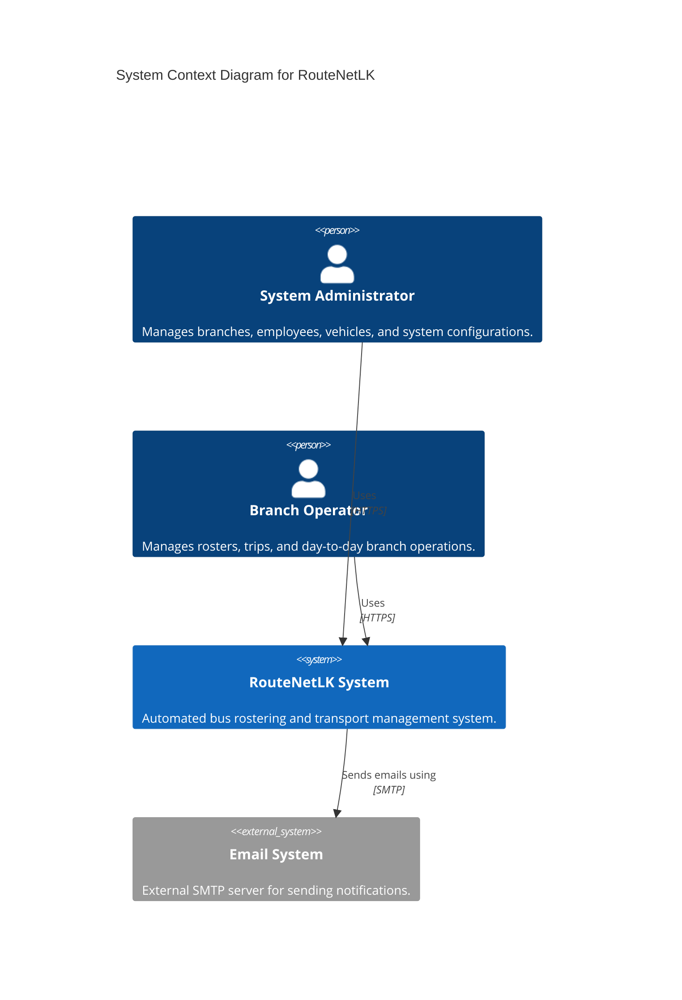
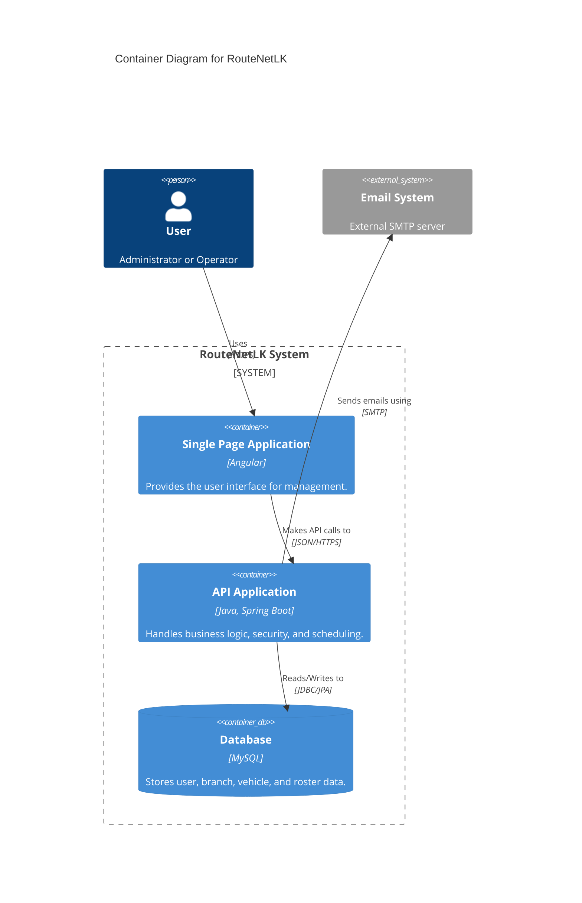
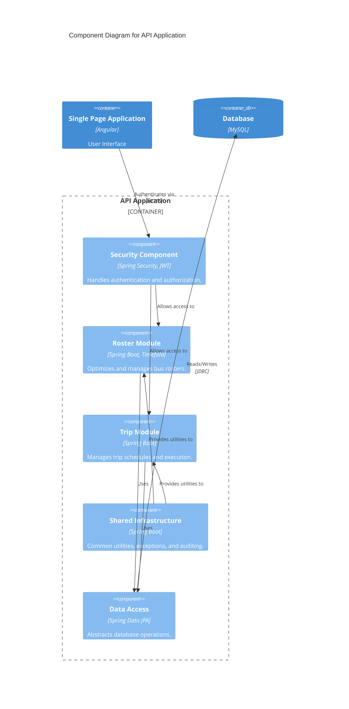

# C4 Model - RouteNetLK System

This document provides a C4 model representation of the RouteNetLK system, covering System Context, Container, Component, and Code levels where applicable.

## 1. Level 1: System Context Diagram

The System Context diagram provides a high-level view of how the RouteNetLK system interacts with its users and external systems.

## 2. Level 2: Container Diagram

The Container diagram shows the high-level technical architecture of the RouteNetLK system.

## 3. Level 3: Component Diagram (API Application)

This diagram focuses on the internal components of the Spring Boot API Application.

## 4. Level 4: Code (Architecture Overview)

The code is organized using a **Module-based Layered Architecture**:

- **Controller Layer**: Handles HTTP requests and maps them to DTOs.
- **Service Layer**: Contains business logic and interacts with specialized engines like Timefold.
- **Repository Layer**: Manages data persistence using Spring Data JPA.
- **Model Layer**: Defines Entities and DTOs.
- **Shared Layer**: Contains cross-cutting concerns like global exception handling, soft delete aspects, and auditing.

### Key Technical Decisions
- **Roster Optimization**: Uses **Timefold Solver** with Interval Trees for efficient scheduling.
- **Data Isolation**: Implements **Hibernate Filters** and AOP to ensure users only see data related to their branch.
- **Security**: Stateless **JWT** authentication with brute-force protection.
