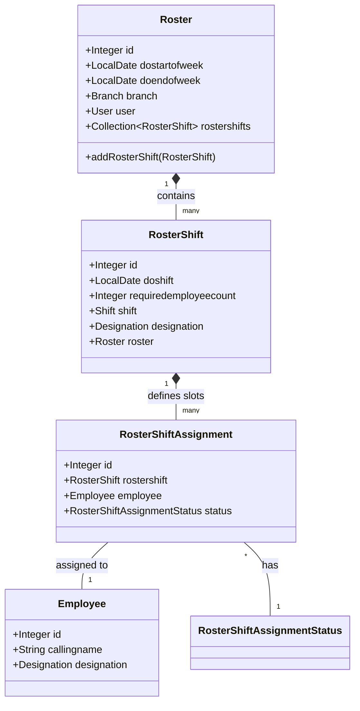
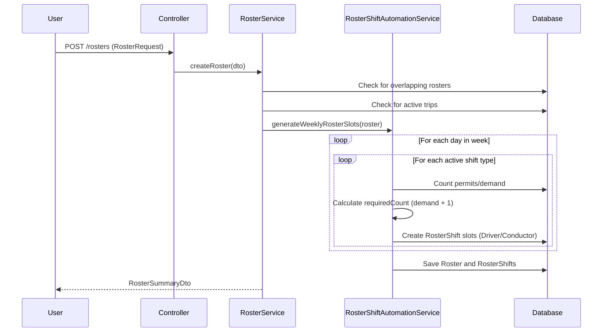
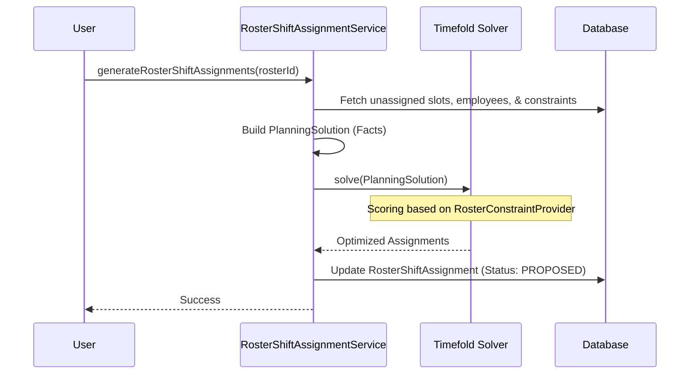

# Low-Level Design (LLD) - Roster Management Module

This document provides a detailed technical specification of the `Roster` module within the **RouteNetLK** system. The module is responsible for managing weekly employee shifts and optimizing assignments using **Timefold Solver**.

## 1. Component Responsibilities

| Component | Responsibility |
|-----------|----------------|
| **RosterService** | Orchestrates roster creation, validation of date ranges, and retrieval of roster summaries. |
| **RosterShiftAutomationService** | Generates `RosterShift` slots for a week based on historical trip demand and permit counts for a specific branch. |
| **RosterShiftAssignmentService** | Handles the assignment of employees to shifts. It integrates with Timefold Solver to generate optimized suggestions. |
| **RosterConstraintProvider** | Defines the Hard and Soft constraints used by the AI Solver to ensure valid and fair assignments. |
| **RosterRepository** | Manages persistence for `Roster` entities, including overlapping range checks. |
| **RosterShiftAssignmentValidator** | Validates state transitions for shift assignments (e.g., DRAFT -> PROPOSED). |

## 2. Class Diagram

The following diagram illustrates the core entities and their relationships.

## 3. Sequence Diagrams

### 3.1. Roster Slot Generation
When a user creates a new roster, the system automatically generates empty slots (Shifts) based on demand.

### 3.2. Automated Assignment Flow (Timefold Solver)
This process uses AI to find the best employee for each shift slot.

## 4. Database Interactions

The module uses **Spring Data JPA** for data access. Key operations include:
- **Overlapping Check:** `rosterRepository.existsOverlappingRoster` uses a custom JPQL query to ensure a branch doesn't have two rosters for the same period.
- **Demand Calculation:** `tripRepository.countDistinctPermitsForShift` counts active permits associated with a branch and shift to determine how many crews are needed.
- **Batch Updates:** `RosterShiftAssignmentRepository.updateEmployeeAndStatusDirectly` is used for high-performance updates after solver completion.
- **Soft Delete:** Entities inheriting from `BaseEntity` are filtered via Hibernate `@Filter` to exclude deleted records.

## 5. Business Rules

### 5.1. Roster Creation Rules
- A roster must span exactly **7 days**.
- There must be at least one **Active Trip** defined for the branch to generate a roster.
- Only one roster can exist for a specific **Branch and Date Range**.

### 5.2. Assignment Constraints (Timefold)
- **Hard Constraints (Must be met):**
    - **Designation Match:** A Driver must be assigned to a Driver slot; a Conductor to a Conductor slot.
    - **No Overlapping:** An employee cannot be assigned to two shifts that overlap in time.
    - **Route Familiarity:** The assigned employee must have a familiarity level matching the route requirements.
- **Soft Constraints (Preferences):**
    - **Workload Balance:** Distribute shifts evenly among available employees to prevent burnout.

## 6. Validation Rules

Validation is handled at both the DTO level (using JSR-303) and Service level.

- **Status Transitions:** `RosterShiftAssignmentValidator` enforces valid state changes:
    - `DRAFT` -> `PROPOSED` | `CANCELED`
    - `PROPOSED` -> `CONFIRMED` | `CANCELED`
    - `CONFIRMED` -> `IN-PROGRESS` | `CANCELED` | `ABSENT`
- **Manual Assignment:** When manually assigning, the system checks if the employee's `Designation` matches the `RosterShift`.

## 7. Exception Handling

The module utilizes a **Global Exception Handling** strategy:
- **BusinessRuleViolationException:** Thrown when a business logic check fails (e.g., overlapping dates). Returns a `400 Bad Request` with a standardized error code.
- **ResourceNotFoundException:** Thrown when a requested Roster or Assignment ID does not exist. Returns `404 Not Found`.
- **ConstraintViolationException:** Automatically thrown during JSR-303 validation failures.

## 8. Transaction Boundaries

- **Atomic Creation:** `RosterService.createRoster` is marked with `@Transactional`. If slot generation fails, the entire roster record is rolled back.
- **Read Consistency:** `getRosterSummary` is marked with `@Transactional(readOnly = true)` to optimize performance and ensure a consistent snapshot.
- **Solver Result Persistence:** `RosterShiftAssignmentService.saveResult` runs in a transaction to ensure all optimized assignments are saved as a single atomic unit.
